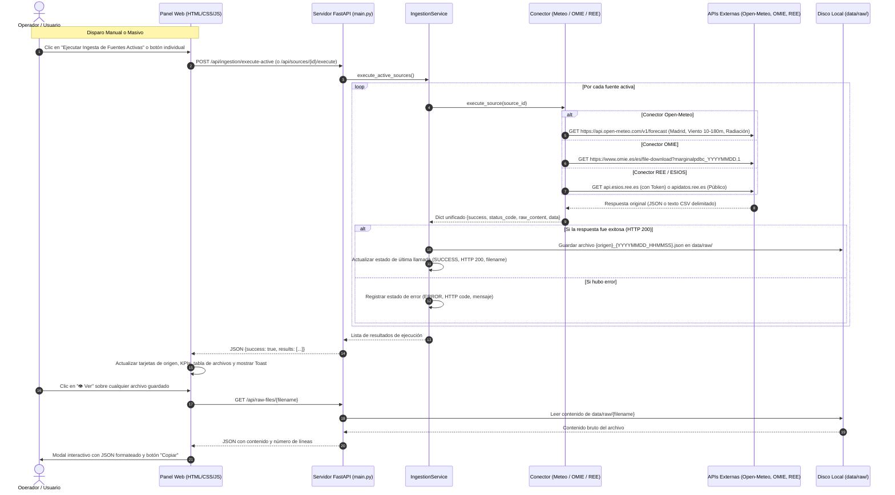

# 🌟 RESUMEN COMPLETO DEL PROYECTO: ECOGRID ANALYTICS (FASE 1)

**EcoGrid Analytics** es una plataforma moderna para la monitorización, ingesta y análisis de datos energéticos y meteorológicos en España.
En esta **Fase 1**, el objetivo ha sido construir el gestor administrativo local y la arquitectura de conectores para adquirir datos brutos desde tres fuentes heterogéneas (**Open-Meteo**, **OMIE** y **Red Eléctrica de España / ESIOS**), almacenándolos en su formato original en la carpeta local `data/raw/` sin persistencia en base de datos.

---

## 📁 1. ÁRBOL DE ARCHIVOS DEL PROYECTO

A continuación se detalla la estructura completa de archivos del proyecto y la responsabilidad específica de cada componente:

```text
EcoGrid_API/
├── .env                           # Variables de entorno locales (puerto, host, tokens de APIs)
├── .env.example                   # Plantilla de ejemplo para variables de entorno
├── README.md                      # Descripción general del repositorio
├── acciones.md                    # Manual detallado de credenciales, tokens externos y acciones pendientes
├── requirements.txt               # Lista de dependencias Python (FastAPI, Uvicorn, Requests, Jinja2, etc.)
├── setup_structure.py             # Script utilitario de andamiaje inicial del proyecto
├── RESUMEN_PROYECTO.md            # Este documento de arquitectura, flujos y manual de uso
│
├── config/
│   └── tasks.yaml                 # Configuración declarativa de tareas automáticas (intervalos, CRON, conectores)
│
├── data/
│   ├── raw/                       # Carpeta de almacenamiento de respuestas en bruto ({origen}_{YYYYMMDD_HHMMSS}.json)
│   ├── sources_state.json         # Estado persistido de fuentes manuales
│   └── scheduler_state.json       # Estado persistido de última ejecución del planificador
│
├── src/
│   ├── __init__.py                # Inicializador de paquete Python src
│   ├── main.py                    # Aplicación FastAPI, servidor ASGI, rutas Jinja2, REST y scheduler endpoints
│   │
│   ├── config/
│   │   ├── __init__.py            # Inicializador del módulo config
│   │   └── settings.py            # Rutas seguras del proyecto, carga de .env y constantes de APIs
│   │
│   ├── connectors/
│   │   ├── __init__.py            # Inicializador del módulo connectors
│   │   ├── meteo_client.py        # Cliente HTTP para Open-Meteo (Madrid, viento multinivel, radiación)
│   │   ├── omie_client.py         # Cliente HTTP para OMIE (precios marginales y curvas de casación)
│   │   └── ree_client.py          # Cliente HTTP para REE (ESIOS con token y fallback público Apidatos)
│   │
│   ├── services/
│   │   ├── __init__.py            # Inicializador del módulo services
│   │   ├── ingestion_service.py   # Servicio de orquestación de ingesta manual y guardado en disco
│   │   └── scheduler_service.py   # Motor orquestador autónomo basado en APScheduler y config/tasks.yaml
│   │
│   ├── static/
│   │   ├── app.js                 # Lógica JavaScript frontend (toggles, tabs, visor YAML, modales)
│   │   └── style.css              # Sistema de diseño CSS corporativo enterprise B2B
│   │
│   └── templates/
│       └── index.html             # Plantilla HTML5 con login, panel manual y vista de automatizador
│
└── venv/                          # Entorno virtual de Python con todas las librerías instaladas
```

### Detalle de Responsabilidades por Archivo:

1. **`src/config/settings.py`**:
   - Centraliza la resolución de rutas mediante `pathlib.Path`, garantizando que ninguna lectura o escritura traspase los límites del directorio raíz de trabajo `EcoGrid_API`.
   - Carga de forma segura el archivo `.env` mediante `python-dotenv`.
   - Provee los parámetros por defecto de geolocalización (Madrid lat 40.41, lon -3.73, zona horaria Europe/Madrid), URLs base y variables de entorno (`HOST`, `PORT`, `DATA_RAW_DIR`, `ESIOS_API_TOKEN`).

2. **`src/connectors/meteo_client.py`**:
   - Encargado exclusivo de comunicarse con la API abierta de Open-Meteo.
   - Petición horaria para Madrid solicitando: temperatura a 2m, humedad relativa a 2m, viento multinivel a 4 alturas (`10m`, `80m`, `120m`, `180m`), dirección del viento a 4 alturas, nubosidad total, radiación directa normal (`direct_normal_irradiance`), radiación global inclinada (`global_tilted_irradiance`) y radiación de onda corta.
   - Retorna un diccionario unificado con el código HTTP, los datos analizados y el contenido textual en bruto para guardado idéntico al origen.

3. **`src/connectors/omie_client.py`**:
   - Encargado de la adquisición de información de mercado eléctrico de OMIE (Polo Español / MIBEL).
   - Descarga directa del archivo público diario de precios marginales horarios (`marginalpdbc_YYYYMMDD.1`) con capacidad de reintento automático para días precedentes si la publicación del día en curso aún no se ha producido.
   - Parsea las 24 horas del mercado marginal para España y Portugal y conserva la cadena original con delimitadores punto y coma.

4. **`src/connectors/ree_client.py`**:
   - Conector especializado para Red Eléctrica de España (REE).
   - Modo Dual Inteligente:
     - Si existe un token personal válido en `ESIOS_API_TOKEN`: Conecta directamente a la API oficial de e-sios (`api.esios.ree.es`) solicitando el indicador 1293 (Demanda real peninsular) y previsiones (indicador 460) con cabecera `Authorization: Token token="..."`.
     - Si el token está ausente o vacío: Conecta de forma transparente con el endpoint oficial público abierto de REE (`apidatos.ree.es/es/datos/demanda/demanda-tiempo-real`), permitiendo probar la ingesta real sin necesidad de esperar la aprobación manual del token por email.
   - Informa en todo momento el origen de la API empleada y si la conexión fue autenticada.

5. **`src/services/ingestion_service.py`**:
   - Orquestador del ciclo de vida de la ingesta.
   - Mantiene el catálogo en memoria y en disco (`data/sources_state.json`) del estado de activación (`active: true/false`) de cada fuente y la información de la última llamada (`status`, `http_code`, `timestamp`, `saved_file`, `summary`, `error`).
   - Implementa `save_raw_file`: Genera marcas de tiempo precisas y guarda los archivos en bruto con la convención solicitada `{origen}_{YYYYMMDD_HHMMSS}.{ext}` dentro de `data/raw/`.
   - Implementa funciones seguras de exploración (`list_raw_files`, `get_raw_file_content`, `delete_raw_file`) protegiendo el sistema de cualquier riesgo de path traversal.

6. **`src/main.py`**:
   - Instancia la aplicación FastAPI y expone tanto la interfaz HTML (`/`) como la API REST:
     - `GET /`: Panel de control interactivo mediante Jinja2Templates.
     - `GET /api/sources`: Catálogo y estado de fuentes.
     - `POST /api/sources/{source_id}/toggle`: Activar o desactivar dinámicamente un origen.
     - `POST /api/sources/{source_id}/execute`: Disparo manual de ingesta individual.
     - `POST /api/ingestion/execute-active`: Disparo masivo de todas las fuentes activas.
     - `GET /api/raw-files`: Listado de archivos en `data/raw/` con metadatos.
     - `GET /api/raw-files/{filename}`: Lectura y previsualización segura de archivos.
     - `GET /api/raw-files/{filename}/download`: Descarga directa del archivo físico.
     - `DELETE /api/raw-files/{filename}`: Eliminación de archivos desde el panel.
     - `GET /api/stats`: Estadísticas globales para las tarjetas KPI.

7. **`src/templates/index.html`**, **`src/static/style.css`** y **`src/static/app.js`**:
   - **Frontend Corporativo Enterprise (B2B)**:
     - **Pantalla de Login Inicial**: Autenticación estricta previa para operadores (`admin` / `admin`) con alerta de seguridad y gestión de sesión en `sessionStorage`.
     - **Diseño Sobrio y Estructurado**: Supresión de bordes redondeados excesivos (bordes rectos de 0px a 3px), supresión total de emojis y adopción de iconografía técnica vectorial SVG (Lucide / estándares Enterprise).
     - **Paleta Corporativa de Alto Contraste**: Tonos oscuros profundos (`#080c14`, `#0d121d`, `#111827`), azul corporativo `#2563eb`, tipografía técnica con soporte monoespaciado para marcas temporales y datos tabulares, botones sobrios y conmutadores industriales rectangulares.
     - **Botón de Cierre de Sesión**: Integrado en el perfil de operador del encabezado para finalizar la sesión en cualquier momento.

---

## 🔄 2. FLUJOS DE DATOS

El siguiente diagrama ilustra cómo viajan los datos desde los proveedores externos hasta el almacenamiento en disco local `data/raw/` y la interfaz del usuario:



### Explicación Paso a Paso del Flujo:
1. **Acción de Usuario**: El operador pulsa el botón de ejecución general o el de cualquier conector individual desde la interfaz web.
2. **Petición REST Asíncrona**: El archivo `app.js` emite una petición `fetch` asíncrona hacia el endpoint de FastAPI correspondiente.
3. **Orquestación en `IngestionService`**: El servicio comprueba si el origen está habilitado. Si lo está, invoca el conector adecuado (`OpenMeteoClient`, `OMIEClient` o `REEClient`).
4. **Consulta Externa HTTP**: El conector realiza la petición HTTP hacia el servidor del proveedor con timeouts configurados y cabeceras adecuadas.
5. **Generación de Nombre y Almacenamiento Local**: Se genera la marca temporal exacta `YYYYMMDD_HHMMSS`. El payload recibido se escribe sin modificaciones en `data/raw/{origen}_{YYYYMMDD_HHMMSS}.{ext}`.
6. **Persistencia de Estado**: Se registra el timestamp, el código HTTP, el nombre del archivo y el resumen en `sources_state.json`.
7. **Refresco Reactivo de la UI**: La interfaz web recibe la confirmación, actualiza la tarjeta del origen con el nuevo estado, recarga la tabla de archivos y notifica al usuario con un toast de éxito.

---

## 🚀 3. INSTRUCCIONES DE EJECUCIÓN LOCAL

Sigue estos sencillos pasos para levantar y utilizar el proyecto localmente en tu equipo:

### Requisitos Previos:
- Python 3.10 o superior (instalado en el sistema).
- Windows PowerShell o terminal compatible.

### Paso 1: Activar el Entorno Virtual
Abre una ventana de PowerShell en el directorio `EcoGrid_API`:
```powershell
.\venv\Scripts\Activate.ps1
```
*(Si la política de ejecución de scripts de Windows está restringida, puedes ejecutar previamente: `Set-ExecutionPolicy -Scope Process -ExecutionPolicy Bypass`)*.

### Paso 2: Verificar Dependencias
Instala o valida que todos los paquetes requeridos estén presentes:
```powershell
pip install -r requirements.txt
```

### Paso 3: Configuración de Variables de Entorno (Opcional)
Comprueba el archivo `.env` en la raíz del proyecto:
```env
PORT=8000
HOST=127.0.0.1
DATA_DIR=data/raw
ESIOS_API_TOKEN=
```
*(Si no dispones de token ESIOS aún, déjalo en blanco; el sistema utilizará el fallback público funcional).*

### Paso 4: Iniciar el Servidor Web
Ejecuta el servidor con Uvicorn:
```powershell
uvicorn src.main:app --host 127.0.0.1 --port 8000 --reload
```

### Paso 5: Acceder al Panel de Control
Abre tu navegador web en la siguiente dirección:
👉 **`http://127.0.0.1:8000`**

### Acciones que puedes realizar en el Panel:
- **Pestaña 1: Control Manual & Repositorio**:
  - **Toggles Dinámicos**: Activa o desactiva cualquiera de los 3 orígenes haciendo clic en su switch selector.
  - **Ejecución Individual**: Pulsa "Ejecutar Ingesta" en la tarjeta de Open-Meteo, OMIE o REE.
  - **Ejecución Masiva**: Haz clic en el botón superior "Ejecutar Ingesta de Fuentes Activas".
  - **Explorador de Archivos**: Visualiza todos los archivos brutos guardados en la tabla inferior, fíltralos por origen o busca por nombre.
  - **Visor de Datos**: Haz clic en el botón "Ver" para inspeccionar el JSON formateado directamente en un modal con opción de copia rápida.
  - **Descarga Física**: Haz clic en "Descargar" para descargar el archivo original en tu equipo.

- **Pestaña 2: Automatizador & Planificador de Tareas (APScheduler)**:
  - **Supervisión de Tareas**: Visualiza en tiempo real el estado de cada conector automático, su intervalo en minutos, fecha/hora de última ejecución y próxima ejecución programada.
  - **Toggles de Tarea**: Habilita o pausa cualquier tarea programada con efecto inmediato en el motor en segundo plano.
  - **Editor de Intervalos**: Modifica la frecuencia de sondeo (en minutos) directamente desde la interfaz y guárdala con un solo clic. El cambio se sincroniza en caliente en `config/tasks.yaml`.
  - **Ejecutar Ahora**: Dispara la ingesta inmediata de cualquier tarea autónoma sin esperar al temporizador.
  - **Inspección de tasks.yaml**: Botón para examinar la configuración declarativa YAML completa en un visor modal.

---

## 📌 4. ACCIONES PENDIENTES (EXTERNAS E INTERNAS)

### Acciones Externas (Claves y Registros):
1. **Red Eléctrica de España (ESIOS)**:
   - **Estado Actual**: Funciona actualmente mediante la API abierta `apidatos.ree.es` (Demanda real, prevista y programada).
   - **Acción Pendiente**: Para acceder a la API oficial de alta resolución de e-sios V2 (`api.esios.ree.es`), enviar un correo a `consultasios@ree.es` solicitando un *Personal API Token*.
   - **Configuración**: Una vez recibido el token, abrir `.env` e introducir `ESIOS_API_TOKEN=tu_token_aqui`.
2. **Open-Meteo**:
   - **Estado Actual**: Totalmente operativo. No requiere claves de API para uso estándar.
3. **OMIE**:
   - **Estado Actual**: Totalmente operativo. Las descargas de precios marginales diarios y curvas agregadas se realizan mediante endpoints públicos directos.

### Estado de las Fases del Proyecto:
- ✅ **Fase 1 (Gestor e Ingesta Bruta Local)**: Implementada y probada al 100%. Almacenamiento en `data/raw/` de Open-Meteo, OMIE y REE.
- ✅ **Fase 2 (Automatizador / Planificador de Tareas Autónomo)**: Implementada al 100% mediante `config/tasks.yaml`, motor `APScheduler` en segundo plano, endpoints REST `/api/scheduler/*` e interfaz de monitoreo y control en tiempo real.
- ⏳ **Fase 3 (Validación y Normalización)**: Crear esquemas Pydantic para validar los datos en bruto guardados en `data/raw/` y transformarlos en esquemas tabulares homogéneos.
- ⏳ **Fase 4 (Base de Datos & Series Temporales)**: Diseñar la capa de persistencia (PostgreSQL / TimescaleDB o DuckDB) para almacenar las series temporales procesadas.
